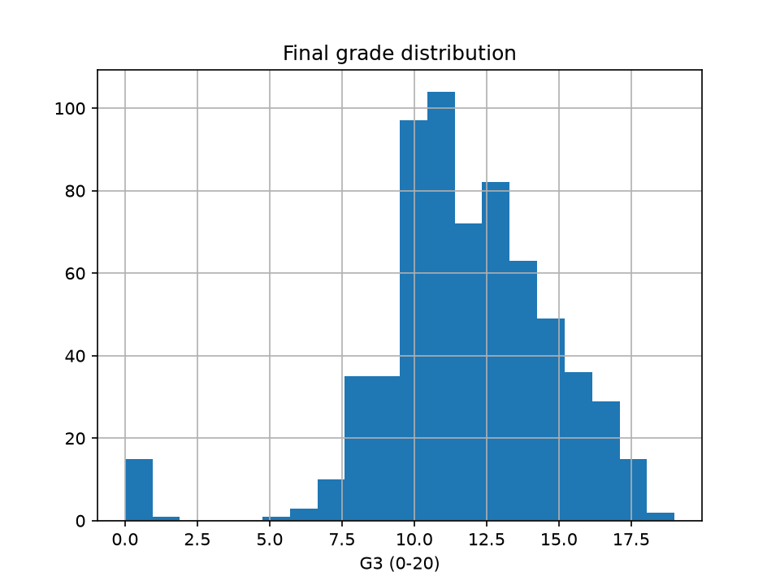

# Executive Summary

This report analyzes academic performance across 649 student records (mean final grade G3 of 11.91 out of 19.0). A Random Forest model using earlier-period grades (G1 and G2) achieves high accuracy with a test R² of 0.841 and MAE of 0.751. However, because earlier-period grades are non-actionable historical markers, a second model excluding G1 and G2 was evaluated (test R² of 0.188, MAE of 2.046). This second model reveals actionable drivers of performance: past failures (importance 0.3137), higher education aspirations (0.0472), absences (0.0303), and weekly study time (0.0253). Administrators can leverage these insights to implement targeted academic support and attendance interventions.

# Methodology

The analysis evaluated 649 student observations across 33 variables with zero missing values. The target outcome variable is the final grade (`G3`), which ranges from a minimum of 0.0 to a maximum of 19.0, with a mean of 11.91 and a standard deviation of 3.23. Exactly 2.3% of final grades are recorded as zero.

Two modeling approaches were executed using Ridge Regression and Random Forest algorithms:

1. **Model With Prior Grades (G1, G2):** Utilizes all 32 predictor features including earlier-period grades G1 and G2. 
   - **Random Forest (Best Model):** Cross-validation R² mean = 0.853, Test R² = 0.